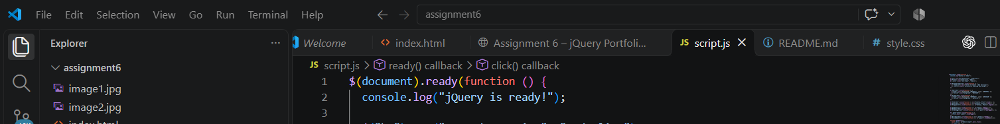
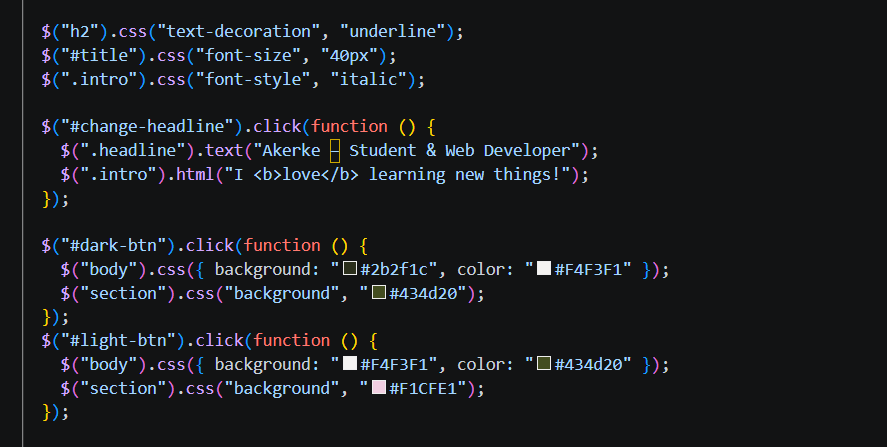
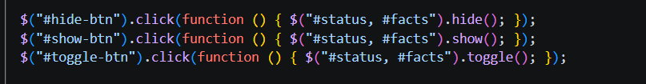
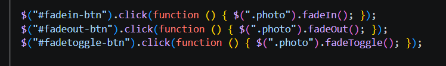
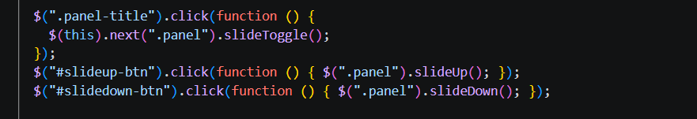
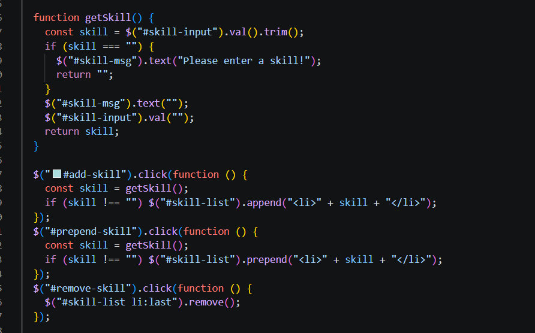
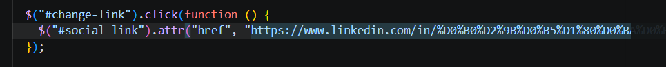
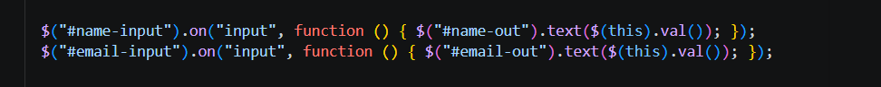
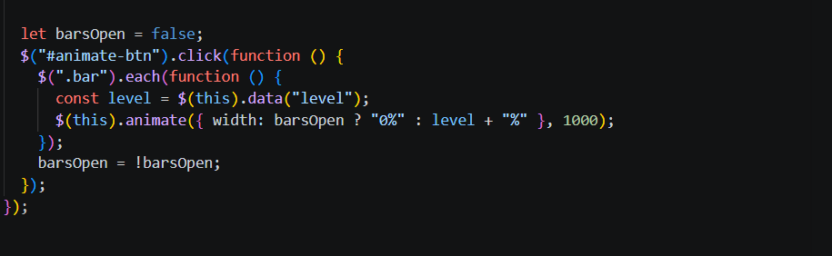

# Assignment #6 – jQuery (Selectors, Effects, Animations)
## Akerke Berdakul IT- 2503

## Part 1. Getting Started with jQuery

### Task 0. Setup
•	Include jQuery from a CDN.
•	Write a $(document).ready(function() { ... }) function.
•	Test by printing “jQuery is ready!” in the console.

### Task 1. Selectors & CSS
•	Display your name, a personal headline, and a short introduction.
•	Include a profile section with a title such as "Welcome to My Portfolio."
•	Use tag, ID, and class selectors to select different HTML elements.
•	Dynamically update your greeting or headline using .text() or .html().
•	Use .css() to change the styling of selected elements.
•	Add buttons to switch between light and dark themes.

## Part 2. jQuery Effects

### Task 2. Visibility Methods
•	Create an "About Me" section 
•	Add a short biography and a current status message, such as "Currently learning jQuery!"
•	Include a few fun facts about yourself, your interests, or your goals.
•	Add three buttons: Hide, Show, and Toggle.
•	Use the buttons to control the visibility of your status message or fun facts.

### Task 3. Fade Methods

•	Display at least two images(your profile picture, favorite hobby, travel photos, or personal projects).
•	Use .fadeIn(), .fadeOut(), .fadeToggle() effects to control the visibility of gallery images.

### Task 4. Slide Methods
•	Create at least three clickable headings, such as "My Favorite Music," "My Favorite Movie," and "My Favorite Subject."
•	Place related information inside a collapsible panel beneath each heading.
•	Use .slideUp(), .slideDown(), .slideToggle()to make the interaction smooth.

## Part 3. DOM Manipulation with jQuery

### Task 5. Add & Remove Elements
•	Display an initial list containing at least four technical skills.
•	Add a text input where visitors can enter a new skill.
•	Create three buttons: "Add Skill," "Prepend Skill," and "Remove Skill."
•	Use .append(), .prepend(), .remove().
•	Prevent empty skills from being added

### Task 6. Modifying Attributes
•	Add a social media link, such as GitHub, LinkedIn, or a personal website.
•	Create a button that dynamically changes the link's destination using .attr().

### Task 7. Form Interaction
•	Create a form with inputs for Name and Email.
•	When the user types, display their input live below the form using .val() and .text().

## Part 4. Animations

### Task 8. Basic Animation
•	Extend Task 5 by creating a visual representation of at least three technical skills using skill bars.
•	Add an "Animate My Skills" button.
•	Initially, the skill bars should have zero width.
•	When the button is clicked, use jQuery's .animate() method to increase the width of each skill bar.
•	Use different target widths to represent different skill levels
•	When the button is clicked again, animate the skill bars back to zero width.

## Summary 
I connected jQuery from a CDN and tested it with $(document).ready(). Then I did the tasks one by one: selectors and themes, show/hide, fade, slide, list changes, the link attribute, the live form and finally the skill bar animation. I tested each part in the browser and the console, then published the project with GitHub Pages.